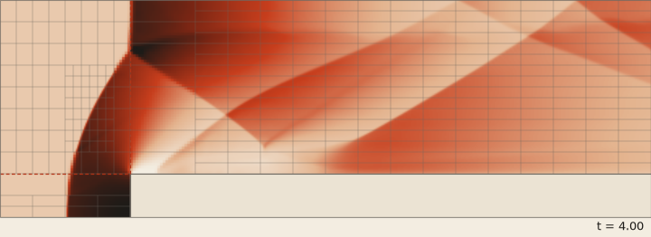
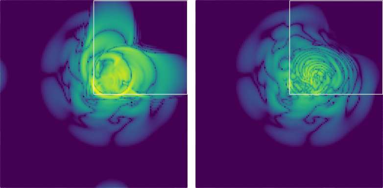
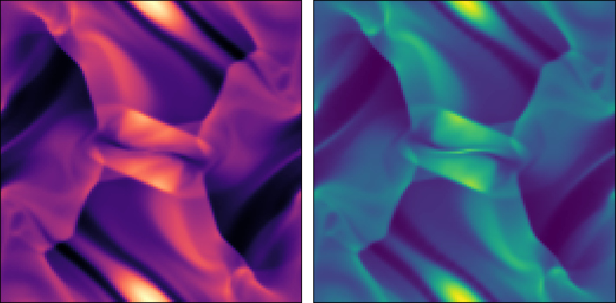
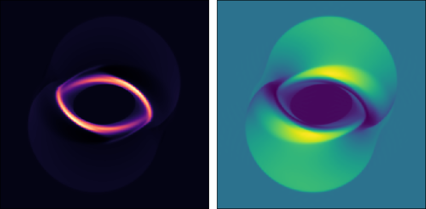
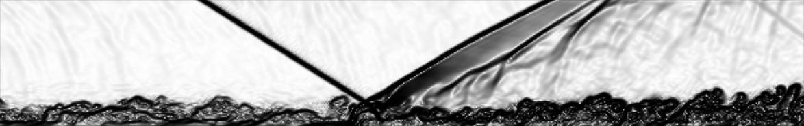
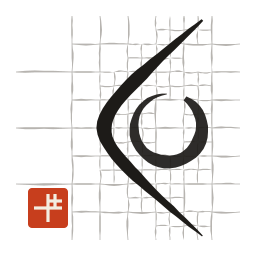

---
metadata:
  - title:            "FLUME on ADAM"
  - subtitle:         "Compressible flows and MHD on adaptive grids, at GPU speed"
  - authors:
    - Stefano Zaghi
  - affiliations:
    - CNR Institute for Applied Mathematics (IAC), Rome
  - date:             "A MaTiSSe showcase, built from one Markdown file"
  - max_time:         20
  - toc_depth:        1
  - dirs_to_copy:
    - images
---

---
reveal:
  theme:          white
  transition:     fade
  center:         false
  width:          1280
  height:         720
  margin:         0.0
  controls:       false
  progress:       true
  slide_number:   false
  plugins:
    - notes
    - math
  custom_css: |
    @import url('https://fonts.googleapis.com/css2?family=Archivo:wdth,wght@62..125,200..800');
    @import url('https://fonts.googleapis.com/css2?family=Inter:wght@400;500;600');
    @import url('https://fonts.googleapis.com/css2?family=IBM+Plex+Mono:wght@400;500');
    /* Sumi on washi: the paper of the code-logo tiles, sumi ink, one vermilion seal. */
    /* NB: MaTiSSe escapes this block, so no child combinators and no ampersands here. */
    :root {
      --paper: #f1ece1; --ink: #1a1714; --ink-2: #4f4a43; --ink-3: #6f685e;
      --rule: #cfc6b6; --grid: #e3dccf; --seal: #c73e1d; --well: #e9e2d4;
      --r-background-color: var(--paper); --r-main-color: var(--ink); --r-heading-color: var(--ink);
      --r-link-color: var(--seal); --r-selection-background-color: #f2c9bd;
      --edge: 76px;
    }
    .reveal-viewport {
      background-color: var(--paper);
      background-image: url('images/washi.svg'),
                        linear-gradient(to right, var(--grid) 1px, transparent 1px),
                        linear-gradient(to bottom, var(--grid) 1px, transparent 1px);
      background-size: 320px 320px, 80px 80px, 80px 80px;
    }
    .reveal { font-family: 'Inter', system-ui, sans-serif; font-size: 26px; color: var(--ink); }
    .reveal .progress { color: var(--seal); height: 4px; }
    .reveal .slides section { text-align: left; }
    .reveal h1, .reveal h2, .reveal h3, .reveal h4 { font-family: 'Archivo', sans-serif; font-stretch: 125%; text-transform: none; color: var(--ink); }
    .reveal .slides section.matisse-decorated { height: 100% !important; }
    .reveal .slide-header-1:empty, .reveal .slide-footer-1:empty { display: none; }
    .reveal p { line-height: 1.45; margin: 0 0 0.6em; }
    .reveal li { line-height: 1.4; }
    .reveal strong { font-weight: 600; }
    .reveal ul { margin: 0 0 0.6em 1.1em; }
    .reveal li::marker { color: var(--seal); }
    /* header: the title over a brush stroke; the slide number as a large, pale extended numeral */
    .reveal .slide-header-1 {
      height: 118px !important; padding: 0 var(--edge) 22px; display: flex; align-items: flex-end;
      background: url('images/brush.svg') no-repeat var(--edge) calc(100% - 4px) / 300px 13px;
      font-family: 'Archivo', sans-serif; font-stretch: 125%; font-weight: 650; font-size: 42px; letter-spacing: -0.025em; line-height: 1;
    }
    .reveal .slide-header-1 span:last-child {
      margin-left: auto; align-self: flex-start; padding-top: 30px;
      font-family: 'Archivo', sans-serif; font-stretch: 125%; font-weight: 200; font-size: 64px; color: var(--rule); letter-spacing: -0.04em;
    }
    .reveal section.matisse-decorated .slide-content {
      padding: 20px var(--edge) 20px; overflow: hidden; display: flex; flex-direction: column; justify-content: center;
    }
    .reveal .columns { display: flow-root; }
    .reveal .column { padding-right: 2%; box-sizing: border-box; }
    /* footer: author and talk in mono, the seal at the right end */
    .reveal .slide-footer-1 {
      height: 62px !important; padding: 0 var(--edge) 22px; display: flex; gap: 1.5em; align-items: flex-end;
      font-family: 'IBM Plex Mono', monospace; font-size: 14px; color: var(--ink-3);
    }
    .reveal .slide-footer-1::after { content: ''; margin-left: auto; width: 24px; height: 24px; background: url('images/seal.svg') no-repeat center / contain; }
    /* figures as prints: an ink frame and a paper mat */
    .reveal img { display: block; margin: 0; border: 1.5px solid var(--ink); padding: 6px; background: #faf7f0; box-sizing: border-box; }
    .reveal img[src$=".svg"] { border: 0; padding: 0; background: transparent; }
    .reveal .muted { display: block; font-family: 'IBM Plex Mono', monospace; font-size: 15px; line-height: 1.5; color: var(--ink-2); margin-top: 12px; }
    /* tables: ink rules; the numbers that matter in vermilion */
    .reveal table { font-size: 21px; border-collapse: collapse; margin: 0 0 0.6em; }
    .reveal table th { font-family: 'Archivo', sans-serif; font-stretch: 112%; font-weight: 600; border-bottom: 2px solid var(--ink); text-align: left; }
    .reveal table td { border-bottom: 1px solid var(--rule); font-variant-numeric: tabular-nums; }
    .reveal table th, .reveal table td { padding: 7px 18px 7px 0; }
    .reveal table strong { color: var(--seal); font-weight: 600; }
    /* code: a well of paper, ink rule on the left, monochrome highlighting */
    .reveal pre { width: 100%; box-sizing: border-box; box-shadow: none; margin: 0 0 0.6em; font-size: 17px; }
    .reveal pre code { font-family: 'IBM Plex Mono', monospace; background: transparent; border: 0; padding: 0; }
    .reveal .highlight pre {
      font-family: 'IBM Plex Mono', monospace; background: var(--well); border-left: 4px solid var(--ink);
      padding: 14px 18px; max-height: none; line-height: 1.5; box-sizing: border-box; width: 100%; overflow: hidden;
    }
    .reveal .highlight { background: transparent; }
    /* title page */
    .reveal .cover { padding: 0; width: 60%; }
    .reveal .cover .kicker { font-family: 'IBM Plex Mono', monospace; font-size: 15px; letter-spacing: 0.12em; text-transform: uppercase; color: var(--ink-3); }
    .reveal .cover h1 { margin: 18px 0 0; font-size: 118px; font-weight: 700; font-stretch: 125%; line-height: 0.88; letter-spacing: -0.045em; }
    .reveal .cover h1 img { display: inline-block; vertical-align: top; width: 34px; height: 34px; margin: 6px 0 0 10px; border: 0; padding: 0; background: transparent; }
    .reveal .cover .sub { margin-top: 28px; font-size: 28px; color: var(--ink-2); line-height: 1.3; max-width: 560px; }
    .reveal .cover .by { margin-top: 70px; font-size: 22px; }
    .reveal .cover .by b { font-weight: 600; }
    .reveal .cover .by span { display: block; color: var(--ink-2); font-size: 18px; }
    /* chapter dividers: a huge extended numeral, one word, a brush stroke */
    .reveal .divider { height: 100%; display: flex; flex-direction: column; justify-content: center; padding: 0 var(--edge); }
    .reveal .divider .num { font-family: 'Archivo', sans-serif; font-stretch: 125%; font-weight: 200; font-size: 230px; line-height: 0.8; letter-spacing: -0.06em; color: var(--seal); }
    .reveal .divider .word { margin-top: 26px; font-family: 'Archivo', sans-serif; font-stretch: 125%; font-weight: 650; font-size: 92px; line-height: 1; letter-spacing: -0.035em; }
    .reveal .divider .stroke { width: 420px; height: 16px; margin: 22px 0 26px; background: url('images/brush.svg') no-repeat left center / 100% 100%; }
    .reveal .divider .what { font-family: 'IBM Plex Mono', monospace; font-size: 20px; color: var(--ink-2); }
theme:
  code:
    style: algol_nu
  layout:
    header-1:
      metadata:
        slidetitle:
          float: none
        slidenumber:
          float: none
    footer-1:
      metadata:
        authors:
          float: none
        title:
          float: none
---

# FLUME on ADAM

## Overview

### Title

#### $titlepage
---
overtheme:
  reveal:
    background_image: images/enso.png
    background_size: auto 112%
    background_position: 106% 50%
  layout:
    header-1:
      height: 0
      metadata: {}
    footer-1:
      height: 0
      metadata: {}
---

<div class="cover">
<div class="kicker">Compressible flows · MHD · adaptive grids · GPUs</div>
<h1>FLUME<br>on ADAM</h1>
<div class="sub">Compressible flows and MHD on adaptive grids, at GPU speed</div>
<div class="by"><b>Stefano Zaghi</b><span>CNR Institute for Applied Mathematics (IAC), Rome</span></div>
</div>

$note
$content{
FLUME is the compressible solver built on ADAM. Every equation, number and picture in this deck comes from its
verification pages.
}
$endnote

#### Method
---
overtheme:
  layout:
    header-1:
      height: 0
      metadata: {}
    footer-1:
      height: 0
      metadata: {}
---

<div class="divider"><div class="num">01</div><div class="word">Method</div><div class="stroke"></div><div class="what">The equations, the adaptive grids.</div></div>

#### The equations

Ideal MHD in conservation form, with the mixed GLM cleaning of Dedner et al. (2002): a ninth variable $\psi$ carries
the divergence error away at speed $c_h$ and damps it.

$$
\frac{\partial \mathbf{B}}{\partial t} + \nabla\cdot(\mathbf{u}\otimes\mathbf{B} - \mathbf{B}\otimes\mathbf{u})
+ \nabla\psi = 0,
\qquad
\frac{\partial \psi}{\partial t} + c_h^2\,\nabla\cdot\mathbf{B} = -\frac{c_h^2}{c_p^2}\,\psi
$$

$columns
$column[width:48%;]
- **Gases:** ideal, isothermal, barotropic; radiative cooling
- **Navier–Stokes:** viscosity, heat conduction
$column[width:48%;]
- **Gravity:** external, self-gravity (FLAIL multigrid)
- **Turbulence:** Vreman, WALE, Sigma; wall models
$endcolumns

#### Adaptive grids

$columns
$column[width:36%;]
ADAM's block-structured quadtree and octree, in Morton order:

- refinement at start-up and at run time
- 2:1 seams with conservative reflux
- one source for CPUs (MPI, OpenMP) and GPUs (OpenACC, OpenMP offload)

<span class="muted">Woodward–Colella Mach 3 step, three quadtree realms.</span>
$column[width:62%;]
{width="100%"}
$endcolumns

#### Evidence
---
overtheme:
  layout:
    header-1:
      height: 0
      metadata: {}
    footer-1:
      height: 0
      metadata: {}
---

<div class="divider"><div class="num">02</div><div class="word">Evidence</div><div class="stroke"></div><div class="what">Orders, oracles and the flows they verify.</div></div>

#### High order across the seams

$columns
$column[width:52%;]
{width="100%"}
$column[width:44%;]
An isentropic vortex crosses a static 2:1 refined quadrant. Density error, $N = 128$:

| Seam operators | max | $L_1$ order |
|---|---|---|
| mean + tricubic | $1.3\cdot10^{-3}$ | 2.0 |
| lagrange6 + quintic | $3.9\cdot10^{-4}$ | **6.1** |

<span class="muted">Left map: default operators. Right: 6-point.</span>
$endcolumns

#### Verified, not just run

Every case has an oracle; the observed order must beat a bound.

| Case | Cells | Observed order | Bound |
|---|---|---|---|
| Isentropic vortex, Euler, WENO | 128 → 256 | **5.79** | 4.5 |
| MHD linear waves, every family | 16 → 32 | **4.96 – 4.97** | 4.7 |
| Viscous shear waves, 4th-order fluxes | 64 → 128 | **4.00** | 3.8 |

$$
p = \frac{\log\left(e_N / e_{2N}\right)}{\log 2}
$$

<span class="muted">Viscous waves: the GPU build gives the same errors and orders to the printed digits.</span>

#### Orszag–Tang and the rotor

$columns
$column[width:48%;]
{width="100%"}

<span class="muted">Orszag–Tang, $t = 0.5$, $128^2$: density, pressure. Symmetric to $1.3\cdot10^{-9}$, conservative to $10^{-14}$.</span>
$column[width:48%;]
{width="100%"}

<span class="muted">MHD rotor, $t = 0.15$, $256^2$: density, $|\mathbf{B}|^2/2$. Symmetric to $1.8\cdot10^{-9}$, floors off.</span>
$endcolumns

#### Shock meets boundary layer

{width="100%"}

$columns
$column[width:48%;]
Mach 2.28, $8^\circ$ oblique shock on a turbulent layer, $Re_\theta \approx 5000$ (IUSTI). Wall-modelled,
$1200 \times 144 \times 72$ cells on 4 A30 GPUs.
$column[width:48%;]
| | FLUME | DNS |
|---|---|---|
| $L_{int}/\delta_0$ | **3.15** | 3.22 – 3.30 |
| reflected shock | $28.95^\circ$ | $29.77^\circ$ inviscid |
$endcolumns

#### Practice
---
overtheme:
  layout:
    header-1:
      height: 0
      metadata: {}
    footer-1:
      height: 0
      metadata: {}
---

<div class="divider"><div class="num">03</div><div class="word">Practice</div><div class="stroke"></div><div class="what">From an input file to a GPU run, and this deck.</div></div>

#### From input to run

$columns
$column[width:50%;]
```ini
[physics]
physical_model = mhd-ideal

[numerics]
scheme_space             = weno
reconstruction_variables = characteristic
reflux                   = .true.

[mhd]
divergence_control = glm
glm_ch             = 4.0

[time]
time_max = 0.5
CFL      = 0.4
```
$column[width:46%;]
Four sections of the Orszag–Tang input. Build for the GPU and run:

```bash
fobis build --mode flume-fnl-nvf
mpirun -np 2 adam_flume_fnl orszag-tang.ini
```

The same input runs on the CPU build (`flume-cpu-gnu`).
$endcolumns

#### This deck

$columns
$column[width:52%;]
One Markdown file, `talk.md`, compiled by **MaTiSSe** to a reveal.js presentation:

- equations in LaTeX, rendered by MathJax
- columns, tables and figures from plain Markdown
- the theme (grid, type, seal) in a YAML block
- speaker notes: press **S**

```bash
matisse build -i talk.md -o out --backend reveal
```
$column[width:44%;]
{width="80%"}
$endcolumns
